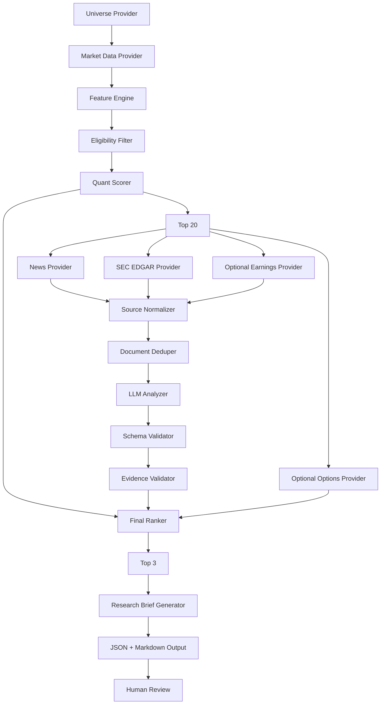

# System Architecture

## Architecture style

Use a modular pipeline with strict separation between:

1. Data acquisition
2. Feature engineering
3. Deterministic scoring
4. Document acquisition
5. AI extraction
6. Final scoring
7. Reporting

Do not create a multi-agent framework for V1.

## High-level diagram



## Architectural rule

The LLM is downstream of quant candidate selection.

Bad:

```text
LLM looks at 500 stocks → tells us what to buy
```

Correct:

```text
deterministic scanner → 20 candidates → LLM researches them
```

## Components

### 1. UniverseProvider

Responsibilities:
- return tradable symbols,
- apply asset-class restrictions,
- optionally enrich symbol metadata.

Interface concept:

```python
class UniverseProvider(Protocol):
    def get_symbols(self) -> list[SymbolInfo]:
        ...
```

### 2. MarketDataProvider

Responsibilities:
- daily bars,
- benchmark bars,
- optional latest quotes.

```python
class MarketDataProvider(Protocol):
    def get_daily_bars(
        self,
        symbols: list[str],
        start: datetime,
        end: datetime,
    ) -> dict[str, DataFrame]:
        ...
```

### 3. FeatureEngine

Pure calculations only.

No network calls.

Input:
- normalized market data.

Output:
- one `FeatureRow` per symbol.

### 4. EligibilityFilter

Pure rules.

Examples:
- price >= threshold,
- 20-day avg dollar volume >= threshold,
- minimum history,
- no missing critical features.

### 5. QuantScorer

Converts normalized features into a 0–100 score.

Must expose component scores.

### 6. SourceProviders

Separate providers:
- NewsProvider
- FilingProvider
- EarningsProvider
- OptionsProvider

Provider failure must not crash the entire run.

### 7. SourceNormalizer

Convert all external documents to:

```text
SourceDocument
- source_id
- symbol
- source_type
- title
- published_at
- url
- text
- provider
- retrieval_time
- content_hash
```

### 8. LLMAnalyzer

Input:
- symbol context,
- selected source documents.

Output:
- strict JSON matching `CatalystAnalysis`.

No free-form trading recommendation.

### 9. EvidenceValidator

For every factual claim:
- confirm at least one referenced source ID exists,
- reject unknown source IDs,
- reject malformed output,
- downgrade analysis when evidence is weak.

### 10. FinalRanker

Combines:
- quant score,
- catalyst score,
- risk gates,
- optional options/liquidity metrics.

No generative model in ranking code.

### 11. ReportGenerator

Produces:
- `summary.json`
- `top20.csv`
- `top3.md`
- per-symbol evidence bundle
- failure report

## Suggested repository structure

```text
trading-copilot/
├── pyproject.toml
├── README.md
├── .env.example
├── config.example.yaml
├── src/
│   └── trading_copilot/
│       ├── __init__.py
│       ├── cli.py
│       ├── config.py
│       ├── logging.py
│       ├── models/
│       │   ├── market.py
│       │   ├── features.py
│       │   ├── sources.py
│       │   ├── analysis.py
│       │   └── results.py
│       ├── providers/
│       │   ├── base.py
│       │   ├── alpaca_market.py
│       │   ├── alpaca_news.py
│       │   ├── sec_edgar.py
│       │   ├── options.py
│       │   └── mock.py
│       ├── pipeline/
│       │   ├── universe.py
│       │   ├── features.py
│       │   ├── eligibility.py
│       │   ├── quant_score.py
│       │   ├── source_collection.py
│       │   ├── ai_analysis.py
│       │   ├── evidence.py
│       │   ├── final_rank.py
│       │   └── report.py
│       ├── llm/
│       │   ├── base.py
│       │   ├── openai_compatible.py
│       │   ├── prompts.py
│       │   └── schemas.py
│       └── storage/
│           ├── cache.py
│           ├── runs.py
│           └── hashes.py
├── tests/
│   ├── unit/
│   ├── integration/
│   ├── fixtures/
│   └── golden/
├── artifacts/
│   └── .gitkeep
└── docs/
```

## Runtime flow

```python
config = load_config()

universe = universe_provider.get_symbols()
market = market_provider.get_daily_bars(universe, ...)
features = feature_engine.compute(market)
eligible = eligibility_filter.apply(features)
ranked_quant = quant_scorer.rank(eligible)
top20 = ranked_quant[:config.scan.top_n]

sources = source_collector.collect(top20)
analysis = llm_analyzer.analyze(top20, sources)
validated = evidence_validator.validate(analysis, sources)

final = final_ranker.rank(top20, validated)
top3 = final[:3]

report_generator.write_run(...)
```

## Error philosophy

A missing news article is not fatal.

A malformed market-data record for a symbol means:
- skip that symbol,
- log reason.

A malformed LLM response means:
- retry once with repair prompt,
- if still invalid, assign no catalyst score,
- never fabricate a replacement.

## Concurrency

Allowed:
- provider requests across symbols,
- document retrieval,
- LLM analysis with strict concurrency limit.

Avoid:
- uncontrolled async fan-out,
- complicated queues,
- distributed systems in V1.
